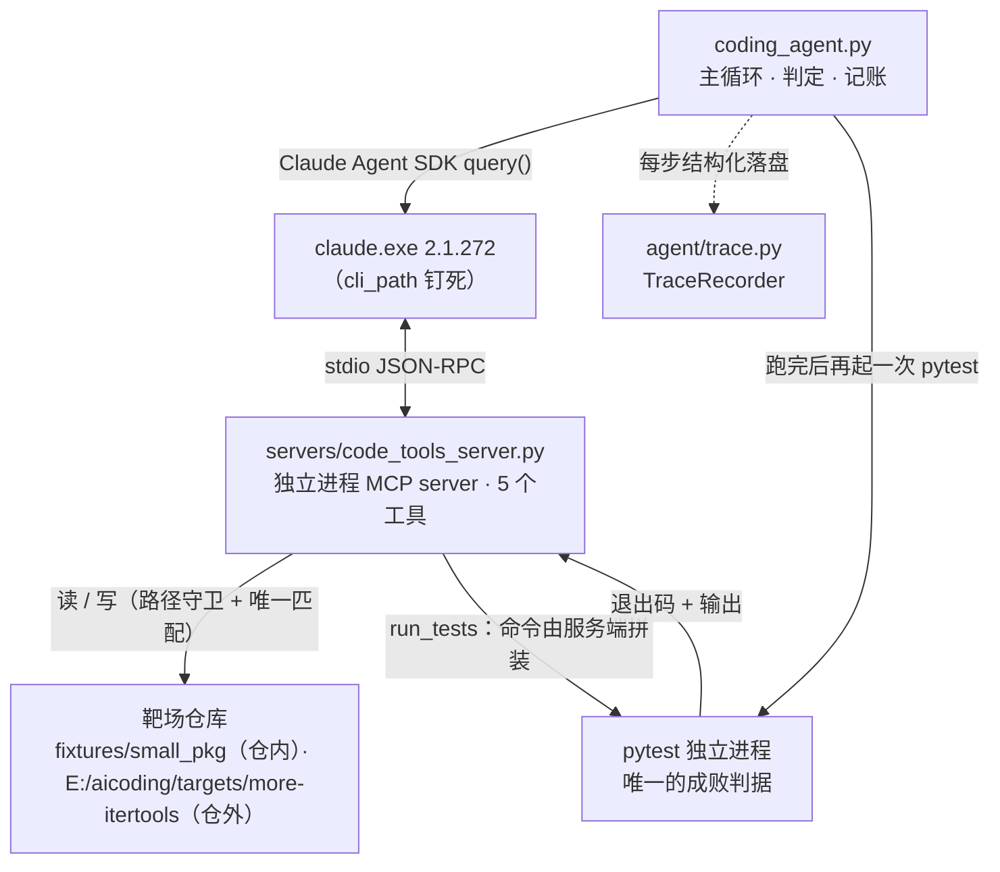

# mini-claude-code

**一个能自己改代码的 Agent。** 给它一个真实开源仓库和一句「测试挂了」，它自己读代码、定位根因、
改源码、跑测试 —— 而**成败由一个独立进程里的 `pytest` 判定，不采信它自己的说法**。

用 **Claude Agent SDK** 从零搭出 Coding Agent 的五个核心层，每一层都要求**有能失败的反向对照**，
不接受「跑通了」当作结论。

**目录**：[30 秒看结果](#30-秒看结果) · [架构](#架构) · [五个必须层](#五个必须层) ·
[四条设计规矩](#四条设计规矩都是被实测逼出来的) · [实测发现](#实测发现) · [怎么跑](#怎么跑) ·
[评测 harness 与 P1 结果](#评测-harnessp0-与-p1-方向性结果) · [仓库结构](#仓库结构) ·
[文档索引](#文档索引) · [不能证明什么](#这个项目不能证明什么) · [许可](#许可)

---

## 30 秒看结果

在 **more-itertools** 上固定提交、注入一个**单行差一错误**（`windowed` 首窗填充数多补一个），
然后让 agent 自己去修：

| 指标 | 实测（12 次运行） |
|---|---|
| 自主修好 | **12 / 12** |
| 判定方式 | 独立 `pytest` 进程的**退出码**（非 agent 自述） |
| 平均耗时 | **97.3 s**（93.9 – 103.6） |
| 回合数 | 11 – 14 turns |
| input token | 10,044 – 17,445 |
| 测试文件被改动 | **0 次**（改测试不算修好） |
| 靶场 commit 前后 | `d21dd31` → `d21dd31`，工作区干净 |

靶场规模：源码 3 文件 / **7,277 行**（`more_itertools/more.py` 单文件 5,644 行），
测试 **768 passed / 21,202 subtests**，MIT，零运行时依赖。

缺陷就一行 —— `more_itertools/more.py:1068`：

```python
# 注入的缺陷
yield tuple(window) + ((fillvalue,) * (n - len(window) + 1))
# 正确写法
yield tuple(window) + ((fillvalue,) * (n - len(window)))
```

我自己独立核过这一对数字（不引用 agent 的自述）：

| 状态 | pytest 输出 | 退出码 |
|---|---|---|
| 缺陷存在 | `2 failed, 767 passed, 21201 subtests passed in 20.88s` | 1 |
| 改掉那个 `+ 1` | `768 passed, 21202 subtests passed in 21.86s` | 0 |

---

## 架构



**为什么工具放独立进程**（而不是进程内 MCP）：① 跨客户端能力已经验证过（同一份 server 被
Claude Code 和 Python 脚本分别使用）；② 天然进程边界 —— 沙箱可以真的靠进程隔离，而不是只靠 `if` 判断；
③ 这让「权限与沙箱」这一层有真实载体。

| 工具 | 权限 | 关键拒绝条件 |
|---|---|---|
| `list_files` | 只读 | root 内；条数上限 200 |
| `search_code` | 只读 | root 内；命中上限 50；正则编译失败报错不崩 |
| `read_file` | 只读 | root 内；单次上限 20,000 字符 |
| `apply_patch` | **写** | root 内；`old` 必须在文件中**唯一出现**，否则拒绝 |
| `run_tests` | **执行** | **不接收命令字符串** —— 命令由服务端拼装，只收受校验的 `test_path` / `keyword`；硬超时 120 s |

---

## 五个必须层

| 层 | 状态 | 实现 | 证据 |
|---|---|---|---|
| ① 自定义 tool + MCP | ✅ | `servers/code_tools_server.py`：独立进程 + stdio，5 个面向代码的工具 | [`VERIFY-agent.md`](VERIFY-agent.md) §2 |
| ② 权限与沙箱 | ✅ | 统一路径守卫 + 唯一匹配 + 命令白名单 + 五重内置工具封锁 | [`VERIFY-agent.md`](VERIFY-agent.md) §3–4 |
| ③ 上下文管理 | ✅ | `repo_map`（AST）+ `run_tests detail=brief` + 输出上限 | [`AB-REPO-MAP.md`](AB-REPO-MAP.md) |
| ④ subagent 分工 | ✅ | `--subagent`：CLI 内建工具 `Task` + `scout` 只读名册（无 `apply_patch`）+ 题面邀请；`--subagent-force` 只做通道阳性对照 | [`SUBAGENT.md`](SUBAGENT.md)（通道探针）、[`AB-SUBAGENT.md`](AB-SUBAGENT.md)（第一轮）、[`AB-SUBAGENT-HARD.md`](AB-SUBAGENT-HARD.md)（第二轮） |
| ⑤ 全链路 trace | ✅ | `agent/trace.py` + `trace_report.py`：11 类卡点检测 + v0 产物适配 | [`TRACE.md`](TRACE.md) |

> 层的编号以 [`DESIGN.md`](DESIGN.md) §10 为准：**④ = subagent 分工，⑤ = 全链路 trace**
> （本表早先两者写反了，已改）。

> ④ 层做完了，但**这一层的收益没有被证明 —— 两轮都指向同一边**：
> 「邀请使用」在第一轮靶场 **0/4 被采用**；把"一步命中"的捷径堵掉、
> 换上需要跨文件定位私有辅助函数的硬靶场之后，**仍然 0/4**。
> 强制使用（阳性对照）时父层 `input_tokens` ×1.68、`cost_usd` ×1.92、成功率不变
> （第一轮 ×1.62 / ×1.68，跨靶场同向）。
> 机制：子代理交回 **6.8–8.1 万字符**的报告，这份报告整个进入父层上下文。
> 需要说清楚的是**子代理本身是称职的**（4/4 找对全部根因、连"同分支写法作佐证"
> 都给了）—— 问题在采用的动机与"把总结搬回父层"的代价。
> 详见 [`AB-SUBAGENT.md`](AB-SUBAGENT.md) §7 与 [`AB-SUBAGENT-HARD.md`](AB-SUBAGENT-HARD.md) §7 ——
> 这里刻意不写「④ 层带来了什么好处」。

---

## 四条设计规矩（都是被实测逼出来的）

### 1. 成败只认独立 `pytest` 的退出码

agent 的自述单独记一栏，两者不一致时以退出码为准。trace 里这两件事**故意分开落盘**：
`outcome`（独立 pytest）与 `agent_stop`（CLI 自报的 subtype）—— 曾经有一次运行
`agent_stop=success` 而 `outcome=failed`，合并成一栏就永远看不见这种分歧。

### 2. 靶场的「坏」必须是 HEAD 的不变量

复位用的是 `git checkout`（**从 HEAD 还原**），所以缺陷必须**提交进靶场 HEAD**，否则第一次复位就把缺陷
一起还原掉了。曾因此静默坏了三个提交：基线 pytest 变成 0、判定「成功」，但**什么都没验证，而且不报错**。
现在有守卫：基线退出码为 0 时**直接中止、不调模型**。

### 3. 可用范围靠 `tools=[]`，不是 `allowed_tools`

这是**反向对照照出来的洞**。只设 `allowed_tools` 时，实测 46 次调用里有
`Bash 19 / Read 9 / Edit 2 / Write 2 / Grep 1`，**其中一次 Read 读到了沙箱之外的文件**。
查 SDK 源码确认语义：`allowed_tools` 是「免询问自动放行」，**不是可用范围白名单**；
禁用全部内置工具要写 `tools=[]`。现在是五重：`tools=[]` + `allowed_tools` + `disallowed_tools`
+ `permission_mode="dontAsk"` + `strict_mcp_config=True`。

### 4. 拒绝必须说明理由

每个工具的每种拒绝都返回具体原因，而不是静默失败 —— agent 需要知道「为什么被拒」才能换路，
**这本身就是失败自省的一部分**。

---

## 实测发现

### 📉 `repo_map` 的旧设计被量化推翻

第一版让 `repo_map` 默认输出全量符号表：**46,776 字符**，其中 **76% 来自测试文件**
（`tests/test_more.py` 有 762 个符号，比源码还多），**超过 20,000 的读取上限，给都给不全**。
而 `search_code` 一次平均只要 **171 字符** —— **贵 274 倍**。
改成摘要后 **359 字符**，便宜 130 倍。

> 教训：**工具价值要按「每次调用成本」衡量，不能按「信息是否更全」衡量。**

### 🔍 上下文压力不随仓库大小线性增长

大靶场基线的 input token（**10,271**）反而**低于**小靶场（10,168–13,504）。
原因是 `more.py` 有 181,098 字符而单次读取上限 20,000 ——
**「全读」这条路物理上不存在**，agent 只能先 `search_code` 定位、再按区间读。

### 🧪 加了工具 ≠ 会被用

A/B 两臂各 6 次（同一靶场、同一缺陷、单变量：`repo_map` 默认详细度 `symbols` vs `summary`），
采用率都是 **1/6**，**未观察到差异**。6 次/臂的样本量不足以区分「1 次」和「2 次」，
所以只能报「未观察到」，不能声称新设计更好、也不能声称两者一样好（[`AB-REPO-MAP.md`](AB-REPO-MAP.md)）。

更值得注意的是：**12/12 次运行都去读了 `README.md` —— 而靶场里根本不存在这个文件**（只有 `README.rst`）。
这更像是**工具没被想到**，而不是它不被需要。所以下一步是改**工具描述**，不是继续调默认详细度。
（这条目前是**假设**，还没验证。）

### 🎯 缺陷是「变异测试」挑出来的，不是拍脑袋写的

对每个候选改动「改一次 → 跑测试 → 记失败数 → 改回去」。选中「填充数多补一个」是因为它
**只挂 2 个测试**，而且是**输出错误**（多一个 `None`）而非「少抛一个异常」——
前者有确定的正确行为可比对。顺带发现上游一个**真实覆盖缺口**：`step < 1 → step < 0`
这个改动挂 **0 个**测试。

---

## 怎么跑

```powershell
# 0) 环境（conda 不在 PATH 上，必须用完整路径）
D:\Anaconda3\Scripts\conda.exe create -n aicoding python=3.12 -y
D:\Anaconda3\Scripts\conda.exe run -n aicoding python -m pip install -r requirements.txt

# 1) 准备大靶场：clone → 固定 SHA → 注入缺陷 → 把缺陷提交进靶场 HEAD
#    重跑安全：已就绪则整段跳过，不会挪动靶场 HEAD（靶场哈希被多份文档冻结，
#    挪了不会报错、但所有「开跑前后 HEAD 一致」的断言都会失效）
#    只想校验现状、不碰任何东西：setup_target.py --check
D:\Anaconda3\envs\aicoding\python.exe setup_target.py

# 2) 让 agent 自己修（判定由服务端独立跑的 pytest 完成）
D:\Anaconda3\envs\aicoding\python.exe coding_agent.py --fixture more-itertools --label demo

# 3) 反向对照：拿掉写工具，它应当如实报告失败，而不是宣称修好
D:\Anaconda3\envs\aicoding\python.exe coding_agent.py --fixture small_pkg --label demo-nowrite --no-write

# 4) 看这次运行的时间线与卡点
D:\Anaconda3\envs\aicoding\python.exe servers\experiments\trace_report.py servers\experiments\out\agent-demo.json

# 5) 检测逻辑自检（10 个用例，含单变量对照）
D:\Anaconda3\envs\aicoding\python.exe servers\experiments\trace_report.py --self-test
```

⚠️ 一律**直接调环境里的 `python.exe`**，不要用 `conda run`：它默认模式下
(a) 缓冲子进程输出、(b) **子进程 stdin 是 EOF** —— 后者会让 MCP server 立刻退出。
必须加 `--no-capture-output`（见 [`SDK-HELLO.md`](SDK-HELLO.md)）。

### 环境

| 项 | 值 |
|---|---|
| conda 环境 | `aicoding`（Python 3.12.14） |
| 包 | `claude-agent-sdk==0.2.152` |
| CLI | `claude.exe` 2.1.272（路径钉死，见 `CLAUDE.md` 陷阱 2） |
| 模型端点 | 第三方 Anthropic 兼容端点（DeepSeek） |

---

## 评测 harness（P0）与 P1 方向性结果

前面几节的靶场缺陷是**我自己注入**的 —— 我知道它在哪。这一阶段换成**真实开源仓库**，
把评测基础设施搭起来：从一个真实修复提交 **revert** 出「有缺陷的起点」，让 agent 去修，
再由 harness 用**独立启动的 pytest** 判定它对没对。

**解决什么**：把「agent 说自己修好了」与「它真的修好了」分开。判定只认 harness 自己
跑出来的 pytest 结果，**agent 的自述对判定零影响** —— 实测到一个反例：某次运行里 agent
自评「未成功」，而独立判定是 `resolved=True`（F2P 5/5、P2P 60/60）；若采信自述就会跟着判错。

**怎么用**：见 [`eval/README.md`](eval/README.md)（可照抄的三条命令）。判据先于数据写死在
[`eval/PREREGISTRATION.md`](eval/PREREGISTRATION.md)（预注册），**定义第一条实例之前 4 小时 12 分
就提交了，此后零改动** —— 判据不是事后补的。

### ⚠ 与官方 SWE-bench 的关系：**语义等价，不是官方 harness**

这条必须写在最前面，否则结论会被放大：

- **未运行官方 harness、未使用官方镜像。** 本仓库是一套**自研的、不依赖 Docker/VM** 的
  评测程序；官方在**依赖安装方式、测试选择、超时策略、题目来源**上都与这里不同。
- **`problem_statement` 取自提交信息**（commit message），**不是**官方 issue 原文。
  难度因此偏向未知 —— 提交信息常常比 issue 更接近答案。
- ⇒ **本批 `resolved` 数字不得与官方 leaderboard 或他人 SWE-bench 子集分数并列比较。**

**P0 只交付基础设施，尚未产出评测数字。** 这一阶段交付的是**预注册 + 12 条真实实例 +
容器无关 harness**，以及「这套 harness 本身可信」的证据（三向自校验、并发隔离、
不采信自述、断点续跑）。**没有任何模型对比结论** —— 那是 P1 的事。

### P1：三臂方向性结果

P1 在 P0 预注册的三臂上比较：A 为 baseline；B 只启用仓库地图检索；C 只启用 driver 强制派发子代理。实际完成 **9 实例 / 27 行（agent_result 23 + timeout 4）+ 9 槽因止损未启动**，不是 12 实例三臂对比已完成。主口径 A **6/9**、B **8/9**；完整配对 B vs A = **2 改进 / 4 平手 / 0 变差**，n=9，未达预注册 n=12，属于检验力不足的探索性方向性结果。臂数 **63/75**，累计成本 **$142.86/225**，本批成本 **$61.38**。只验证出 1 组改进 B；第二组 C 未获可比测量，C 不作「更差」或「能力 3/5」结论。C 的前置开销与 900.02–900.03 s timeout 证据见结果节。

详见 [P1 预注册及结果节](eval/P1-PREREGISTRATION.md) 与 [REV2](eval/P1-PREREGISTRATION-REV2.md)（REV2 只管运行次数/成本上限，不改判据）。本批是语义等价自建 harness，未运行官方 harness，数字不得与官方 leaderboard 并列；父层成本下降不等于端到端更便宜。

### 交付物

| 文件 | 内容 |
|---|---|
| [`eval/PREREGISTRATION.md`](eval/PREREGISTRATION.md) | 预注册：实例 schema、纳入判据、`resolved` 判据、三向自校验、并发与不变量、口径与非外推声明 |
| [`eval/README.md`](eval/README.md) | 复现步骤、目录约定、依赖与常见故障处置 |
| [`eval/build_subset.py`](eval/build_subset.py) | 实例构造器（从真实修复提交 revert 出 12 条实例，跨 4 个纯 Python + pytest 仓库） |
| [`eval/harness/`](eval/harness/) | 容器无关 harness：独立工作区 + 独立 venv + 独立 pytest 判定 + 进程池并发 + 断点续跑 |
| [`eval/gold_check.py`](eval/gold_check.py) | 黄金三向自校验（gold / 空补丁 / 错补丁） |
| [`eval/reports/`](eval/reports/) | 独立复核 `p0-verification.md`、端到端冒烟 `p0-smoke.md`、独立审查 `p0-review-t9.md` 及各自脚本 |

### P0 的已知限制（必须与结论一起读）

- **网络未强制隔离**（§2.3 保守处理）：实例运行时不保证断网。
- **缺陷分布受筛选条件支配**：实例只选自「**同一个提交里同时改了源码与测试**」的修复，
  这不是随机样本。
- **n = 12，跨 4 个小型纯 Python 库 ⇒ 不外推。** 任何小于约 15 个百分点的差异都不可解读为效应；
  单模型单配置，**不构成模型间比较**。
- **没有 Docker 镜像 / conda 环境**：环境类失败会落进我们的 `infra_error`，**不是 agent 能力问题**。
- **第三向（错补丁）在 3/12 条上无额外判别力**（详见 `eval/reports/p0-verification.md`）。
- **§4.2 的 F2P 准入是对冻结文本的「按目的细化」**：实现只排除「基线本来就红」的 node，
  与公式的字面读法不同；**12 条里 10 条**在字面读法下不成立（见下方"偏离声明"）。
- **`usage.jsonl` 的成本字段**：t5 冒烟那次为 null，已在 t8 修复（`7e64816`），
  但**修后尚未重跑一次真实 agent 复核**。
- **并发隔离不变量曾经不成立**：t4 独立复核发现共享 venv 的 `.pth` 竞态可造成**静默误判**
  （实测 6 轮触发 6 次，其中 2 次判定用的是别人的工作区）。**已在 t8 修复**（提交 `7e64816`，
  venv 改为按「实例 + run」隔离）；修复后同场景 6 轮 **0 infra、0 静默误判**。

### t9 独立审查的四项裁定（原样落纸，不美化）

1. **§4.2 的偏离性质 = 「细化」，不是「越权」；但必须声明为「偏离」。**
   从归档的原始 pytest report 重算 12/12：F2P 里**没有任何**「基线本来就红」的 node，
   字面读法下 F2P 为空 ⇒ 该实例被 E5 淘汰。**影响面：12 条里 10 条**在字面读法下不成立
   （而 §7.1 禁止降低判据凑数）。判「细化」的依据：§4.2 自己的**目的句**只把排除范围限定为
   「基线上本来就红的测试」；与官方 SWE-bench 的 F2P 语义一致；**规则文本未被偷改**
   （`git diff` 对 `PREREGISTRATION.md` 为空，差异写在抽样日志与各实例的 `known_limits` 里，
   10/10 都在）；且「基线红就排除」这条路径仍然活着（另有实例因基线本就有病被淘汰）。
   **若要守字面读法，正确路径是重新预注册**（回改 §1–§9 会毁掉冻结性），代价是 **10/12 条不可用**
   —— 审查者的结论是不建议。**不得写成「预注册本来就这么说」。**
2. **3 条 tabulate 实例「第 3 向无额外判别力」= 接受，不要求重做。**
   这 3 条的 `wrong_patch` 与 `patch` **逐字节相同**、生成方法标为 `reverse_of_gold` ⇒
   链式施加净效果等于基线、与第 2 向同状态。**3/12 条少一向判别力。**
   harness 层「能干净 apply 但改错 ⇒ 判 unresolved」的判别力**由其余 9 条独立证成**
   （那 9 条第三向是 `unrelated_file_comment`，干净 apply + 结果 unresolved）。
3. **README.md 被丢弃那条 = 按规则丢弃、且已留痕，不是漏掉。**
   按 §3.1 分类规则第 3 条「非 `.py` 一律丢弃并记入 `known_limits`」处理。
   全量 23 条扫描：有非 `.py` 改动未被点名的实例数 = **0**。pilot-12 里**没有**任何修复提交
   改到 `README.md`；README 系文件出现在 more-itertools 两条（`README.rst`，已点名）与
   2 条 tabulate **reserve**（`README.md`，`known_limits` 原文已写明）。
   ⚠ **方法论坑**：tabulate 的 `known_limits` 固定条目里含 `--doctest-glob=README.md` 这类文本，
   **只用 basename 子串匹配会「假通过」** —— 必须按显式的「丢弃…：<列表>」条目核对。
4. **t9 的两条 low finding**（结论对、说法错的那种，已在本轮修掉）：
   - **F1**：t8 说「不传 `trace` 时行为与改动前**逐字一致**」**字面不成立** ——
     同进程对比，写盘行**新增 1 个键 `usage_source`**，删除键 0、既有键的值变化 0。
     已在 `servers/experiments/usage_log.py` 改成准确表述，并保留 `usage_source`
     （让产物自描述是对的，不反向迁就一句不严谨的表述）。**这是对 t8 表述的更正。**
   - **F2**：t8 对 D7 的**结论成立、数字精确复现**（注入 CRLF ⇒ 251,255 B；归一化 ⇒ 1,268 B，198.2×），
     但**机理讲错了**：`git diff` **并没有**归一化行尾（字节模式 254,616 B / CRLF 3,361 处），
     是 harness 的 `env.sh()` 以 `text=True` 读子进程输出（universal newlines）折掉了 CRLF。
     归档件 `t5-smoke/agent_candidate_patch.diff` 的 CRLF=0 正是这个**读法**造成的，
     它是**损失性产物**，不能用来证明「采集时正文没有 CRLF」（独立证据：该归档件里
     `pyproject.toml` 212/213 对 `-`/`+` 行逐字相同 —— 若正文真的没有 CRLF，git 不会产出这些 hunk）。
     已在 `eval/harness/judge.py` 更正注释。附带一条给 P1 的提醒：受该读法所限，
     **harness 采集到的补丁文本天然不含 CRLF**，所以「补丁正文行尾」这条防线永不触发，
     真正生效的只有工作树归一（`normalize_worktree_eol`）。
   - 另有一处纯装饰性的陈旧帮助文本：`--timeout-probe` 的帮助原写「压到 1s」，
     实际是 **0.2s**，已顺手改成与代码一致。

---

## 仓库结构

```
mini-claude-code/
├─ coding_agent.py            主循环 · 独立判定 · 记账 · 唯一 argparse（13 个开关）
├─ agent/
│  ├─ config.py               端点加载 · 摘父进程环境 · 凭据脱敏 · UTF-8 输出
│  └─ trace.py                TraceRecorder（每步结构化落盘）
├─ servers/
│  ├─ code_tools_server.py    独立进程 MCP server · 5 个面向代码的工具
│  └─ experiments/            trace_report.py 等实验脚本；out/ 是运行产物（证据留原始字节）
├─ fixtures/                  仓内靶场：mini_repo（2 文件）/ small_pkg（20 文件）
├─ eval/                      预注册 · 实例构造 · 容器无关 harness · 独立审查报告
└─ setup_target.py 等          靶场准备：大 / 4 缺陷 / 硬（setup_multi / setup_hard）
```

仓外（不进仓库）：`E:\aicoding\targets\`（more-itertools 三档靶场）、
`E:\aicoding\eval-runs\`（评测工作区与证据）、`E:\aicoding\eval-venvs\`（每实例独立 venv）。

---

## 文档索引

| 文件 | 内容 |
|---|---|
| [`DESIGN.md`](DESIGN.md) | **项目立项**：目标、架构、工具清单与权限边界、验收标准、实施分解 |
| [`VERIFY-agent.md`](VERIFY-agent.md) | agent 闭环的**四组验收**原始输出 + 6 项沙箱对照 + 「本阶段不能证明的事」 |
| [`TRACE.md`](TRACE.md) | **全链路 trace**：数据结构、检测项、反向对照、七个坑、不能证明的事 |
| [`AB-REPO-MAP.md`](AB-REPO-MAP.md) | **A/B 实验报告**：`repo_map` 默认详细度对采用率的影响（含独立复核与勘误） |
| [`VERIFY.md`](VERIFY.md) | 端点配置优先级的四格隔离实验 |
| [`VERIFY-mcp.md`](VERIFY-mcp.md) | 独立进程 stdio + 跨两个客户端的完整原始输出 |
| [`SDK-HELLO.md`](SDK-HELLO.md) | SDK 最小验证（端点优先级 / 密钥归因 / MCP 两形态对照） |
| [`CLAUDE.md`](CLAUDE.md) | **60 条实测陷阱**（给接手这个仓库的 agent 看） |
| [`AGENT.md`](AGENT.md) | 接手速查 |

---

## 这个项目**不能**证明什么

写在这里是为了让结论不被放大：

- **不是 benchmark。** 缺陷全是**我自己注入**的，我当然知道它在哪 —— 真实 GitHub issue
  的定位难度不可比，不能外推。规模也小：3 个注入式靶场（`mini_repo` / `small_pkg` /
  `more-itertools` 的三代）、每臂 4–12 次运行。
- **模型不可换结论。** 全部运行走同一个第三方端点，换模型后上面所有数字都要重测。
- **A/B 的样本量不够。** 每臂 4–6 次，区分不了「1 次」和「2 次」，只能报「未观察到差异」；
  ④ 层第二轮更暴露出这条规则的一个具体漏洞：**采用率为 0 时，两臂比较测的是噪声，
  而噪声恰好能让"极差区间不重叠"成立**（见 [`AB-SUBAGENT-HARD.md`](AB-SUBAGENT-HARD.md) §7.3）。
- **`slow_step` 的阈值是拍的。** trace 里「相邻记录间隔 > 30 s」判为慢步骤，这个 30 s 没有依据。
- **subagent 那一层的收益没被证明。** 层是做完了（⑤ 个必须层都完成了），但两轮 A/B 里
  「邀请使用」**都是 0/4 被采用**（第一轮靶场把函数名免费送出、第二轮把这条捷径堵掉了，
  结论没变）；强制使用（阳性对照）时父层上下文 ×1.68、成本 ×1.92、成功率不变。
  子代理本身是称职的（4/4 找对全部根因）—— 所以这既不是「subagent 没用」，
  也不是「subagent 有用」（见 [`AB-SUBAGENT-HARD.md`](AB-SUBAGENT-HARD.md) §7）。
- **④ 层的实验里，子代理和父 agent 共用一个工作区。** 父 agent 的补丁会在子代理
  侦察期间改掉它正在读的代码（C-2 因此去翻不存在的"备份产物"、烧光回合预算）。
  只读侦察的前提在共享工作区下**不成立**，本轮的数据是在这条缺陷存在时取得的
  （见 [`SUBAGENT.md`](SUBAGENT.md) §7.2）。
- **没有真实 GitHub issue 的闭环、没有 Docker 化、没有录屏。**

---

## 许可

本项目代码以 [MIT](LICENSE) 发布（Copyright © 2026 kingjone0）。

评测实例（[`eval/instances/`](eval/instances/)）中的补丁、测试与提交信息来自上游开源仓库
（[python-tabulate](https://github.com/astanin/python-tabulate) ·
[more-itertools](https://github.com/more-itertools/more-itertools) ·
[click](https://github.com/pallets/click) ·
[pluggy](https://github.com/pytest-dev/pluggy)），版权归各自作者，按 MIT / BSD-3-Clause 分发；
每个实例文件都带 `source_repo_url` 与 `fix_commit` 字段可溯源。

---

<sub>这个仓库同时是一次方法练习：**先量化再动手**、**正向跑通证明不了任何事（必须有能失败的反向对照）**、
**复核者的数字也会错（必须附产物与位置）**。</sub>
