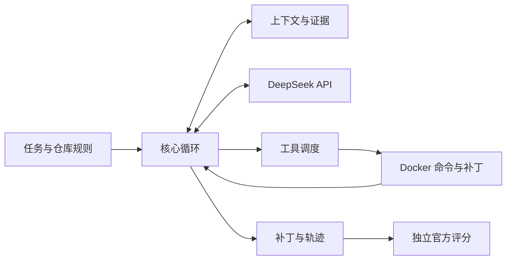

# Coding Harness

基于 DeepSeek 模型独立实现的最小 Coding Agent，可自主阅读代码、应用补丁并运行测试。

## 环境与配置

依赖 Git、Python 3.11+ 和 Docker（Windows 需开启 WSL2 集成）。

```sh
git clone https://github.com/piaoyun2022/coding-harness.git
cd coding-harness
cp .env.example .env
```
在 `.env` 文件中填写：`DEEPSEEK_API_KEY=你的密钥`

## 运行评测 (SWE-bench Lite)

脚本会自动构建容器环境、执行 Agent 修复、运行官方测试并生成报告。结果写入 `artifacts/` 目录。

**Linux / WSL**
```sh
bash scripts/evaluate.sh
```

**Windows PowerShell**
```powershell
powershell -ExecutionPolicy Bypass -File scripts/evaluate.ps1
```

**常用参数：**
```sh
# 环境预检（不发模型请求）
bash scripts/evaluate.sh --preflight

# 指定跑 Agent前 30 题，2 路并发
bash scripts/evaluate.sh --mode agent --limit 30 --workers 2

# 全量 300 题，同时跑裸模型和 Agent
bash scripts/evaluate.sh --mode both --limit 300 --workers 2
```

## 修复本地仓库

```sh
python -m venv .venv
source .venv/bin/activate  # Windows: .venv\Scripts\Activate.ps1
pip install -e .

python -m coding_harness run \
  --repo /path/to/your/repo \
  --task "修复问题并运行测试" \
  --output artifacts/my-task
```
目标仓库代码保持不变，补丁和运行轨迹保存在 `--output` 目录。

## 架构与文档



- **文档**：[项目总报告](docs/project-report.md) | [开发约定](AGENTS.md)
- **评测**：[评测结果](docs/evaluation-results.md) | [评测指南](docs/evaluation.md)
- **源码**：[代码映射](docs/code-map.json) | [依赖说明](THIRD_PARTY_NOTICES.md)