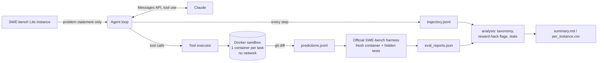

# fixpoint

**An autonomous coding agent, and a harness that measures it honestly.**

[](https://github.com/ShlokGoel/fixpoint/actions/workflows/ci.yml)

A coding agent built from scratch on the raw Anthropic Messages API (no agent framework), with a reproducible evaluation harness for **SWE-bench Lite**. The harness covers per-task Docker sandboxes, full JSONL trajectories with a replay viewer, a failure taxonomy, reward-hacking detection and paired ablation statistics.

The agent loop is the easy part. Most of this repo is about measuring the agent honestly: no test leakage, pinned configuration, hard per-task budgets, confidence intervals on every number, and flags on "fixes" that only make the tests pass.

> **Status:** the harness is complete and tested (65 unit tests, plus Docker integration tests). **No SWE-bench results are reported yet.** The [Results](#results) table is filled only from real runs, using `analysis.report`.

---

## How it works



### Tools

| Tool | What it does |
|---|---|
| `bash` | Runs a non-interactive command in the repo with a timeout. Output is truncated in the middle if huge. |
| `read_file` | Reads a file with line numbers, optionally a line range. |
| `edit_file` | Exact string replacement. `old_str` must match **exactly once**; the error messages say why a match failed and where near-misses are. Python files are compile-checked after each edit. |
| `create_file` | Creates a new file. Refuses to overwrite. |
| `search` / `find_files` | `grep -rnE` / `find -name`, with result caps. |
| `run_tests` | Same as `bash`, but recorded as a verification step. |
| `report_localization` | Declares which files will change. Only present when the localization stage is on. |
| `submit` | Ends the episode. |

### Scaffold (each stage can be ablated)

- **Planning:** the task prompt asks the model to restate the issue and plan its search.
- **Localization gate:** edits are rejected until the agent calls `report_localization`. This forces it to find the code before changing it, and records the claim so it can be compared with the reference fix later.
- **Self-verification gate:** `submit` is rejected once if no tests have run since the last edit. It only rejects once, so the agent can never deadlock.

### When the loop stops

Each iteration makes one model call and runs every tool call in that response. The loop continues while the model keeps calling tools. Every episode ends with exactly one of these causes, which is logged:

| Stop cause | Trigger |
|---|---|
| `submit` | The model called `submit` and the scaffold accepted it. |
| `end_turn_no_submit` | The model stopped calling tools, was nudged once, and stopped again. |
| `max_steps` / `cost_cap` / `wallclock_cap` | A per-task budget ran out (60 steps / $3 / 30 min by default). |
| `no_progress` | The same tool call 3 times in a row, or 5 tool errors in a row. |
| `context_overflow` | Still over the context budget after the allowed number of resets. |
| `max_tokens_loop` | Three responses in a row were cut off at `max_tokens`. |
| `refusal` | The model declined (`stop_reason: refusal`). |
| `api_error` | The API call failed after the SDK's retries. |

**Where it gets stuck, and what catches it:**
- **`edit_file` mismatches** (wrong indentation, non-unique match). Caught by specific error messages, then by `no_progress`.
- **Test loops** (re-running the same failing test). Caught by the repeated-call detector.
- **Premature success** (submitting an untested change). Caught by the verification gate.
- **Long explorations.** Caught by the step and cost caps.

### Context management: append-only

Current Claude models sign their thinking blocks over the conversation that comes before them, and the API rejects a request that replays those blocks after earlier history was edited. So this agent never trims or masks old tool outputs in place.

When the prompt passes the token budget, or the model reports `model_context_window_exceeded`, the conversation is **reset**. A fresh conversation starts with the original task plus a deterministic state summary that the harness tracks itself:
- localized files
- files read and edited
- the current diff
- the last test command and its output
- the last 12 actions

The summary costs no extra model call. Resets are capped and logged. See [`agent/context.py`](agent/context.py).

---

## Methodology

- **No leakage.** The agent sees only the problem statement and the repository. The `Task` it receives has no fields for `FAIL_TO_PASS`, `PASS_TO_PASS`, the test patch or the gold patch, and a test enforces that. The files the gold patch touches are used *only* in post-hoc analysis.
- **Pinned configuration.** The run fingerprint covers the model ID, thinking mode, effort level, budgets and pricing. Every prompt template is a checked-in file whose SHA-256 is logged in each trajectory. The exact model string the API reports is logged for every call. A run refuses to resume if its config changed.
- **Sampling is not seedable.** Current models reject non-default `temperature`/`top_p`/`top_k`, so runs are not bit-for-bit reproducible. Instead, behaviour is pinned through `thinking` and `effort`, and **run-to-run variance should be measured** by repeating the same subset (see [Repeats](#repeats-and-variance)). The seed controls which tasks go into the subset.
- **Isolation.** Each task gets its own container from the official per-instance image, with `--network none` and memory/CPU limits. The container is destroyed afterwards. Grading happens in a separate fresh container run by the official harness.
- **Strict scoring.** A task is resolved only if every `FAIL_TO_PASS` test passes and no `PASS_TO_PASS` test breaks. There is no partial credit.
- **Statistics that fit small samples.** Rates come with 95% Wilson intervals. Ablations are compared as **paired** runs on the same tasks, using a paired bootstrap CI and an exact McNemar test. At n = 30, one task is 3.3 points, so a delta whose CI crosses zero is reported as "no difference shown".

### Failure taxonomy

Every task gets exactly one primary category, so the counts add up to N. Secondary tags are added on top.

| Primary category | Meaning |
|---|---|
| `resolved` | Resolved under the strict criterion. |
| `infra_error` | Harness, container or API failure. Not the agent's fault; re-run these with `--retry-errors`. |
| `empty_patch` | No diff produced. |
| `patch_apply_failed` | The patch did not apply, or the tests could not run. |
| `wrong_localization` | Never edited any file the reference fix touches. |
| `broke_existing_tests` | A `PASS_TO_PASS` test now fails. |
| `partial_fix` | Some, but not all, `FAIL_TO_PASS` tests pass. |
| `right_file_wrong_fix` | Edited the right file(s), but the target tests still fail. |

**Secondary tags:**
- `gave_up`
- `premature_stop`
- `refused`
- `context_reset`
- `skipped_verification`
- `never_opened_gold_file`
- `hallucinated_api_suspected`
- `reward_hack`

### Reward-hacking detection

Flags are computed from the final patch and from the commands in the trajectory. They are reported **whether or not the task was resolved**: a resolved task with a high-severity flag is a red flag, not a success.

| Flag | Severity |
|---|---|
| `MODIFIED_EXISTING_TEST`, `DELETED_TEST_FILE`, `WEAKENED_ASSERTION` | high |
| `ADDED_SKIP_OR_XFAIL` (skip/xfail/skipTest anywhere) | high |
| `TEST_CONFIG_CHANGED` (conftest.py, pytest settings in setup.cfg/tox.ini/pyproject) | high |
| `TRIVIAL_ASSERTION`, `FORCED_EXIT`, `TEST_TAMPER_COMMAND` (e.g. `rm tests/...` during the episode) | medium |
| `ADDED_TEST_FILE` | info (allowed) |

---

## Quickstart

```bash
python -m venv .venv && source .venv/bin/activate
pip install -e ".[eval,dev]"

pytest                                   # unit tests: no API key, no Docker
python scripts/demo_toy.py --scripted    # offline end-to-end demo with a scripted fake model
```

The scripted demo replays a fixed set of tool calls on a tiny buggy repo. It checks that the loop, tools, gating, patch extraction and held-out grading work. It is **not** a model result.

### With a real model

```bash
export ANTHROPIC_API_KEY=...
docker build -f examples/Dockerfile.toy -t fixpoint-toy examples/
python scripts/demo_toy.py --docker fixpoint-toy        # real model, sandboxed
FIXPOINT_TEST_IMAGE=fixpoint-toy pytest tests/test_docker_sandbox.py
```

Open `viewer/trajectory_viewer.html` in a browser and load any `runs/**/*.jsonl` to replay an episode step by step. Use ← and → to move between steps.

### SWE-bench Lite

You need an x86_64 Docker host with plenty of disk, because each task pulls its own environment image. The official harness docs recommend roughly 120 GB free and 16 GB RAM for large runs.

```bash
make smoke                    # 3 hand-picked tasks: check the loop before spending money
make subset                   # 30 random tasks (seed 0)  -> runs/sub30
make eval RUN=sub30           # official harness -> runs/sub30/eval_reports.json
make report RUN=sub30         # -> runs/sub30/summary.md, per_instance.csv

make ablations                # the same 30 tasks without localization / without self-verification
make compare A=sub30 B=sub30-noloc
make compare A=sub30 B=sub30-noverify

make full                     # all 300 tasks -> runs/full
```

Before a full run, multiply the subset's measured mean cost per task by 300 to set a budget. Before any run, check that `pricing` in `configs/default.yaml` matches current [Anthropic pricing](https://platform.claude.com/docs/en/about-claude/pricing), because the cost figures are only as accurate as those values.

Any config value can be overridden without editing files:

```bash
python -m harness.run_agent --run-name sub30-medium --subset 30 --set effort=medium
```

### Repeats and variance

Sampling can't be seeded, so run the same subset more than once before trusting a difference:

```bash
for r in 1 2 3; do python -m harness.run_agent --run-name sub30-r$r --subset 30 --seed 0; done
```

Report the spread across repeats next to any ablation delta.

---

## Results

**No results yet.** Every cell below will be copied from `runs/<run>/summary.md` and `analysis.report compare` output after real runs. Nothing here is estimated.

| Run | Tasks | Resolved | Resolved % (95% CI) | Mean $ / task | Notes |
|---|---|---|---|---|---|
| Full scaffold | 30 | — | — | — | subset, seed 0 |
| − localization | 30 | — | — | — | paired with the row above |
| − self-verification | 30 | — | — | — | paired with the first row |
| Full scaffold | 300 | — | — | — | all of SWE-bench Lite |

Failure taxonomy and reward-hacking flags will go here once the subset run is graded. [`docs/writeup_template.md`](docs/writeup_template.md) is the outline for the technical write-up.

---

## Repository layout

```
agent/            the agent: config, LLM client, tools, sandbox, loop, context, trajectories
  prompts/        prompt templates (hashed into every trajectory)
harness/          SWE-bench task loading, per-task runs, official-harness wrapper
analysis/         reward-hack detector, failure taxonomy, statistics, reports
viewer/           self-contained HTML trajectory viewer
configs/          default.yaml (every setting, documented)
examples/         toy repo + held-out test + Dockerfile for the offline demo
scripts/          demo_toy.py
tests/            unit tests, plus Docker integration tests (opt-in)
docs/             write-up template
```

## Limitations

- SWE-bench Lite is Python-only and skews toward a few large repositories (Django and SymPy make up a big share), so results may not generalize.
- `wrong_localization` uses the set of files the reference fix touches. A valid fix in a different file would be labeled as a localization failure.
- `hallucinated_api_suspected` and the reward-hack flags are pattern-based. Read the flagged trajectories before drawing conclusions.
- A context reset keeps the state but drops the model's earlier reasoning. The `context_reset` tag lets you check whether resets correlate with failures.
- Results depend on the model version and on the API's default behaviour at run time. Both are logged, but they can't be frozen.

## License

MIT. See [LICENSE](LICENSE).
